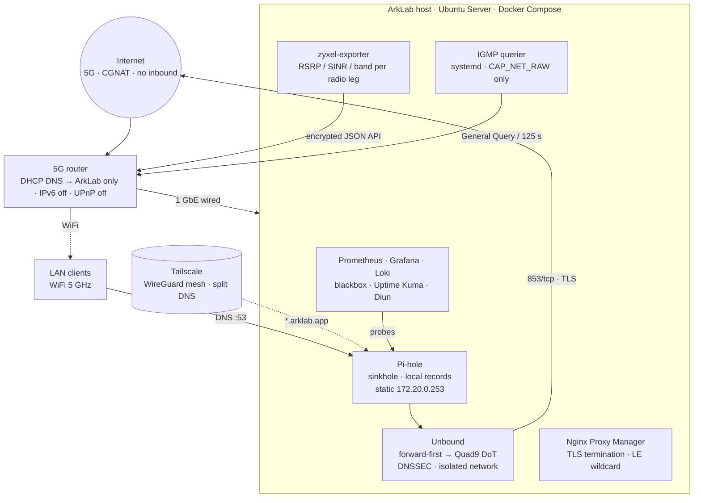

<div align="center">

# ArkLab

**A self-hosted homelab engineered like production: private DNS, zero-trust remote access, fail-closed observability — and every outage turned into a detection rule.**


</div>

> **This is the sanitised public mirror of a private operational repository.** Addresses, identifiers and anything environment-specific are placeholders or removed, and the history is a single commit by design. See [What is deliberately not here](#what-is-deliberately-not-here).

---

## What it is

A repurposed laptop running Ubuntu Server provides a whole household's DNS (sinkhole + DNSSEC + DNS-over-TLS), reverse proxy with a Let's Encrypt wildcard, VPN remote access, and a complete metrics/logs/alerting stack — with **zero cloud dependency and zero inbound ports**. Internet arrives over a 5G cellular link behind carrier-grade NAT, which turns the WAN itself into something that has to be measured and reasoned about.

Everything runs in Docker Compose (24 containers across 10 stacks, every image pinned to an explicit version), plus a handful of custom Python services on the host where a container can't do the job.

The interesting part is not the service list. It is the **operating discipline**: every incident in this lab produced a root cause, a structural fix, and a detection rule that would have caught it. The four write-ups in [`docs/post-mortems/`](docs/post-mortems/) are the best place to start.

## At a glance

| | |
|---|---|
| **Host** | Ubuntu Server LTS · 4 cores · 15 GiB · Docker Compose, all images pinned |
| **WAN** | 5G NSA (LTE anchor + n78) behind CGNAT — no inbound possible |
| **DNS** | Pi-hole → Unbound → Quad9 over DNS-over-TLS, DNSSEC validated locally |
| **Ingress** | Nginx Proxy Manager, `*.arklab.app` wildcard via DNS-01, nothing exposed to the internet |
| **Remote** | Tailscale (WireGuard mesh) with split DNS — the same HTTPS URLs work remotely |
| **Metrics** | Prometheus (15 s scrape, 30 d retention) · node-exporter · cAdvisor · blackbox · a custom 5G exporter |
| **Logs** | Loki + Promtail, with a redaction stage for credentials |
| **Alerting** | 13 Grafana rules provisioned from the repo, fail-closed (`NoData → Alerting`) · Uptime Kuma · Telegram |
| **Secrets** | `.env` files mode 600, never committed · root scripts source `/etc/arklab/*.env` · CI refuses relative volume paths |
| **Updates** | `unattended-upgrades` for the OS · Diun notifies on new image tags, nothing auto-updates |

## Architecture



**Why the host runs the IGMP querier, and why Unbound forwards instead of recursing:** both are answers to faults that were measured, not assumed. See the post-mortems.

## Engineering highlights

### 1. The host is the LAN's IGMP querier
A smart speaker kept vanishing from discovery hours after joining the network — ping fine, unicast fine, multicast dead. `tcpdump` showed the router *snoops* IGMP (it joins the all-snoopers group) but never sends General Queries, so group memberships age out and are never refreshed. One hand-crafted query brought the speaker back in four seconds. The structural fix is a 150-line RFC 2236 querier running as an unprivileged systemd service with exactly `CAP_NET_RAW`, a proper querier election, and receive bound to the LAN interface so a Docker-bridge container can never vote it out. → [`docs/post-mortems/01-igmp-querier.md`](docs/post-mortems/01-igmp-querier.md) · [`host/igmp-querier.py`](host/igmp-querier.py)

### 2. Resolver design has to match the link
Full recursion is the worst possible DNS workload for a lossy cellular link: 3–5 UDP exchanges per cold lookup, and in the link's bad hours 61–68 % of forwarded queries went unanswered, Unbound's per-zone rate limiter tripped under the retry storm, and the house saw intermittent `ERR_NAME_NOT_RESOLVED`. Switching to forward-first over a single DNS-over-TLS session (with recursion kept as fallback and DNSSEC still validated locally) cut `requestlist.exceeded` from ~940/day to ~25/day. → [`docs/post-mortems/02-dns-on-a-lossy-5g-link.md`](docs/post-mortems/02-dns-on-a-lossy-5g-link.md)

### 3. A shutdown unit that silently never ran for three months
`ExecStart` + `WantedBy=shutdown.target` + `Requires=docker.service` looks correct and is a well-known trap: at shutdown the unit's start job is cancelled against Docker's queued stop job, with **no journal entry**. Every shutdown had gone through dockerd's 15-second SIGKILL. Rewritten to the `RemainAfterExit` + `ExecStop` pattern and proven with `journalctl -b -1`. The post-boot counterpart gates every stack on `docker compose config -q`, refuses to recreate containers (boot is not a deploy mechanism), and detects restart loops that `docker ps` reports as "Up". → [`docs/post-mortems/03-the-shutdown-unit-that-never-ran.md`](docs/post-mortems/03-the-shutdown-unit-that-never-ran.md)

### 4. Containers had never reached the resolver
Pointing container DNS at the host's LAN IP never worked: Docker excludes bridge-originated traffic to the host's own address from its DNAT rules, and the firewall drops the rest. For six months every container had been silently resolving through Docker's public fallback — unfiltered, unlogged, invisible to every dashboard. The fix gives Pi-hole a reserved static address on the shared bridge and removes the fallback on purpose: a resolver outage must fail loudly. Three blackbox DNS *assertion* probes (sinkhole, local record, recursive) now guard that path. → [`docs/post-mortems/04-containers-never-reached-the-resolver.md`](docs/post-mortems/04-containers-never-reached-the-resolver.md)

### 5. Fail-closed detection
Every detection rule in [`monitoring/grafana/provisioning/alerting/detection.yml`](monitoring/grafana/provisioning/alerting/detection.yml) treats *no data* as *alerting*, because a missing metric means the exporter, cron job or probe behind it has died. Cron-driven exporters refuse to publish partial data — on failure the output file is left untouched and its `last_run_seconds` goes stale. Where a fault has a cause and an effect, both get a sensor (querier alive *and* speaker discoverable).

### 6. A Prometheus exporter for a router that encrypts its own API
The 5G router's web UI wraps every API call in an RSA-negotiated AES-256-CBC session. [`monitoring/zyxel-exporter/exporter.py`](monitoring/zyxel-exporter/exporter.py) implements the handshake, performs a stateless login → fetch → logout per scrape so no admin session is held open, and exports RSRP/RSRQ/SINR per radio leg. That exporter is what revealed the 5G NR leg had been detached for two weeks (the modem re-anchored to a band that couldn't carry it); a band lock fixed it and a sentinel-value alert now watches for it.

## Security posture

| Layer | Detail |
|---|---|
| Inbound | None. CGNAT enforces it; the design doesn't rely on that — zero router port forwards, UPnP off |
| Remote access | Tailscale only, WireGuard end-to-end; split DNS so remote clients use the normal HTTPS URLs |
| Firewall | UFW default-deny. **Docker-published ports bypass UFW** (the `DOCKER` chain precedes `INPUT`), so exposure is controlled at the compose level: no published ports unless a LAN client needs them, host-only binds (`127.0.0.1:`) where only the host does |
| SSH | Non-standard port · key-only · root login off · keyboard-interactive off (verified with `sshd -T`) · Fail2ban |
| DNS privacy | No plaintext upstream; DNSSEC validated locally; Unbound reachable only from Pi-hole's private network (two independent layers: network membership and `access-control`) |
| Privilege separation | Operator account has one `NOPASSWD` sudo grant: the cert-reload hook. Custom host daemons run unprivileged with a single ambient capability under a hardened systemd sandbox |
| Secrets | Never in the repo, never on a `sudo` command line (argv lands in `auth.log` → Loki), never in an HTTP client's debug log (loggers pinned to `WARNING` at import time; Promtail redacts the token pattern as defence in depth, not control) |
| Supply chain | Every image pinned to an explicit tag; a digest pin where the publisher doesn't tag. Diun reports newer tags daily; upgrading is a deliberate commit |
| Router | Admin UI LAN-only · WPS/UPnP/TR-069 off · config backups encrypted with GPG, outside the repo |

## Observability

- **Blackbox probes split the WAN from the LAN:** ICMP to the gateway *and* to two public resolvers every 15 s. Gateway bad = local problem; gateway good + WAN bad = cellular problem.
- **DNS assertion probes** check that the resolver is *doing its job*, not merely alive: `doubleclick.net → 0.0.0.0` (sinkholing), a local record (`dns.hosts` intact), and a DNSSEC-signed public name through the full recursive path.
- **TLS expiry** is probed on the lab's own wildcard with a `tls_scope=internal` label, alerted at 21 days — because the cert once sat expired for 46 days after ~107 silent renewal failures.
- **Textfile collectors** for anything that can't be scraped: Pi-hole gravity/blocklist health from SQLite, IGMP querier heartbeat, an mDNS multicast-path probe. All written atomically (`tmp` + `rename`), all fail-closed.
- **Boot and shutdown** send a Telegram summary: container count, health, restart loops, stack failures.

## Operating principles

1. **Every failure in this lab so far has been silent.** For any automated job, two questions: does it log, and does anything alert when it stops?
2. **Verify by content, not by exit status.** `install` succeeding proves a file was copied, not that it holds the intended version.
3. **Validate before writing, never after.** A runbook that writes to five places and tests last propagates a bad value everywhere before failing.
4. **A healthcheck must pass when the service works *and* fail when it doesn't.** Pin probes to `127.0.0.1` (container `localhost` resolves to `::1` even with IPv6 off); never make a liveness probe WAN-dependent.
5. **A fallback that works is a fault that hides.** Prefer loud failure over quiet degradation.
6. **Capture forensics before any container recreation**, not just before reboots — `compose up -d` destroys container logs.
7. **Boot is not a deploy mechanism.** Changed config ships by a deliberate `up -d`, gated on `config -q`, committed immediately.

The full list, with the incidents that produced each rule, is in [`docs/design-principles.md`](docs/design-principles.md).

## Why a data engineer runs this

Most of what makes a pipeline trustworthy is the same discipline that makes a network trustworthy: idempotent jobs, dependency-ordered start-up and tear-down, schema-validated inputs before anything is written, atomic publishes, staleness as a first-class signal, secrets that never touch a log, and post-mortems that end in a test. This lab is where I practise those habits on a system that bites back immediately — when DNS breaks, the whole household knows within a minute.

## Repository layout

```
.
├── README.md
├── docs/
│   ├── design-principles.md          # conventions this lab is run by
│   └── post-mortems/                 # four root-cause write-ups
├── dns/
│   ├── docker-compose.yml            # Pi-hole + Unbound (isolated private network)
│   └── unbound/                      # unbound.conf + forward zone (Quad9 DoT)
├── monitoring/
│   ├── docker-compose.yml            # Prometheus, node-exporter, cAdvisor, Loki, Promtail,
│   │                                 # Grafana, Uptime Kuma, blackbox, autoheal, Diun, 5G exporter
│   ├── prometheus/  blackbox/  promtail/  loki/  diun/
│   ├── grafana/provisioning/alerting # system.yml + detection.yml — alert rules as code
│   ├── zyxel-exporter/               # custom exporter (encrypted router login)
│   └── scripts/                      # textfile collectors: Pi-hole metrics, mDNS probe
├── host/
│   ├── igmp-querier.py / .service    # RFC 2236 querier, hardened systemd unit
│   ├── arklab-shutdown.sh / .service # graceful stop in dependency order (ExecStop pattern)
│   └── arklab-post-boot.sh           # gated bring-up + verification
└── .github/workflows/validate.yml    # compose config · relative-path refusal · shellcheck · py_compile
```

## What is deliberately not here

- Real LAN, VPN and tailnet addresses, hostnames of client devices, and bot identifiers — all replaced with placeholders or removed. Nothing in this repo is reachable from the internet anyway; the omission is a principle, not a necessity.
- The media stack, two personal Telegram agents, and the change log. They are private by nature and add nothing to the engineering story.
- Router configuration backups, certificates, keys, `.env` files, runtime data. These never enter *any* repo, public or private.
- Git history. The private repo's history contains rotated-but-real credentials from an early mistake (see post-mortem 3's lessons); this mirror starts clean.

## Roadmap

- Second always-on box: second Pi-hole as DHCP DNS #2 (closes the single point of failure — never a public resolver, clients race rather than fail over), GPU-hosted LLM, `restic` pull backups with an append-only repo + small offsite set, restore drill before sign-off
- UPS with `nut` → Grafana and a graceful-shutdown trigger
- Cold-lookup DNS probe (the cached `dns_recursive` probe stayed green through one outage)
- `unbound_exporter` for `requestlist.exceeded`
- CNAME-delegated `_acme-challenge` zone to shrink the DNS API token's blast radius

## License

MIT — see [`LICENSE`](LICENSE). Use anything here; the post-mortems are the part most worth stealing.
